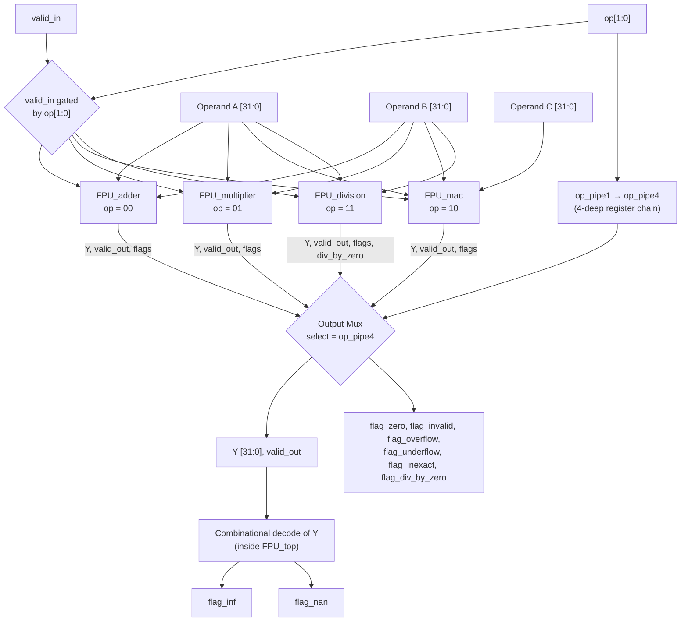
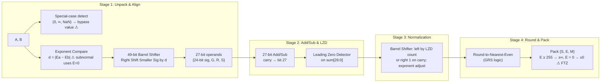
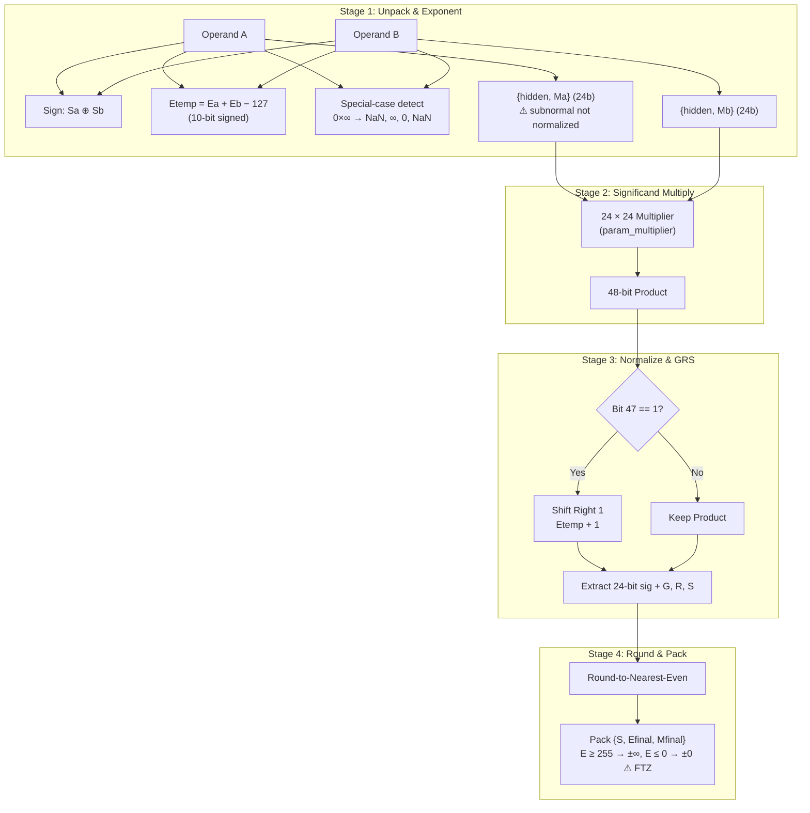
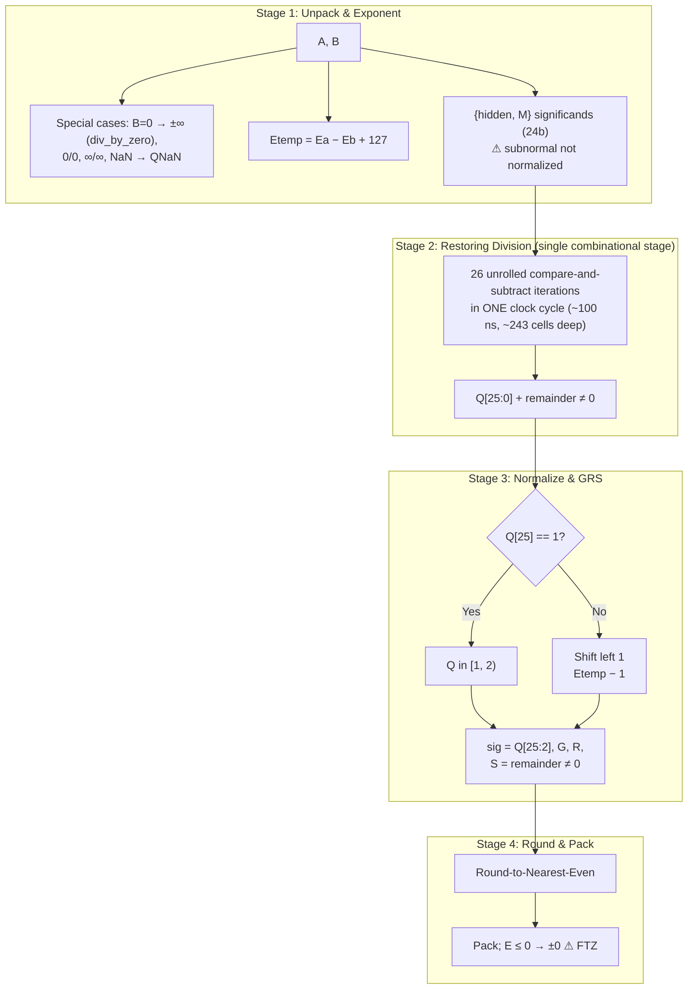
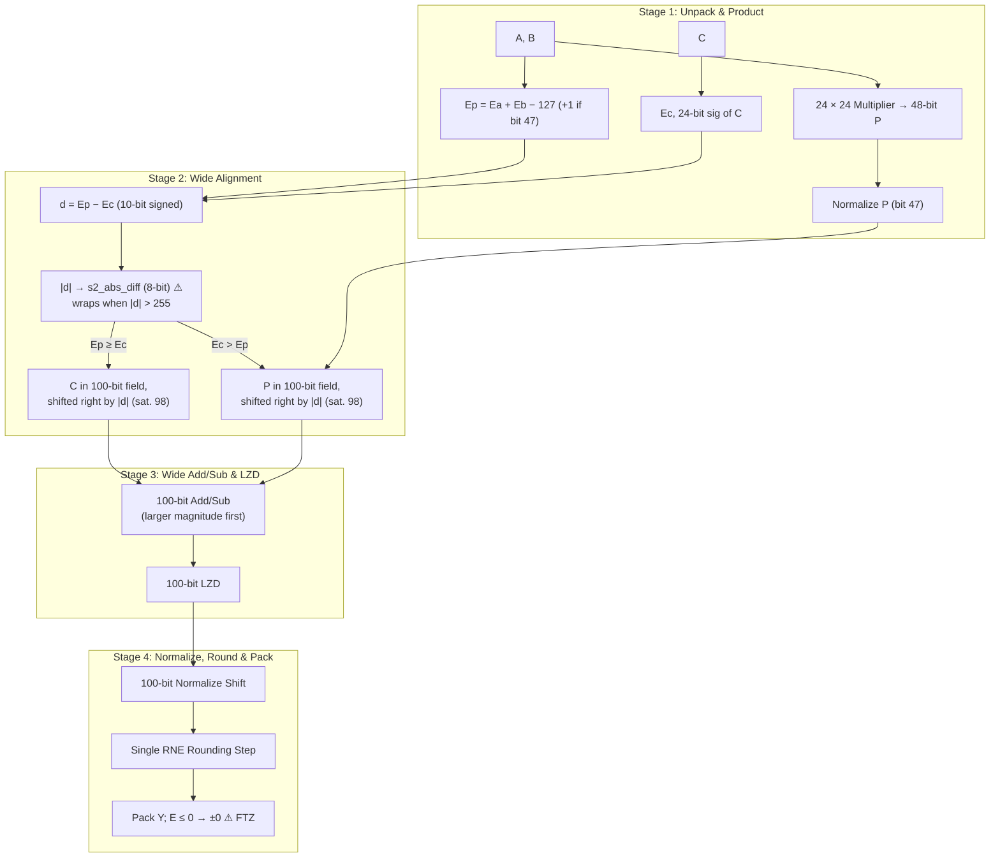

# Floating-Point Unit System Architecture & Block Diagrams

These diagrams follow the RTL as it is. Every unit has **4 register stages** and accepts one operation per cycle. Nodes marked ⚠ are where the independent bit-exact audit (2026-10-18) found deviations from IEEE 754; see [`documantation/architecture.md` §4](../documantation/architecture.md#4-deviations-from-ieee-754).

## 1. Top-Level Unified FPU Core (`rtl/FPU_top.v`)

- The four units run in parallel on one clock, so the slowest one (the divider) sets the `FPU_top` clock: **min period 100.506 ns (≈9.95 MHz)** in Sky130 synthesis.
- `input_convertor` / `output_convertor` are **not** part of `FPU_top`. They are standalone components, tested separately in `tb_fpu_top.v`.

---

## 2. FPU Adder Pipeline (`rtl/FPU_adder.v`)

⚠ Bypass returns `B` when `A` is zero, so `+0 + −0 → −0`. Any NaN operand sets `flag_invalid`.

---

## 3. FPU Multiplier Pipeline (`rtl/FPU_multiplier.v`)

---

## 4. FPU Divider Pipeline (`rtl/FPU_division.v`)

The Stage 2 loop is the critical path of the whole FPU. Splitting it across pipeline stages, or using SRT / Newton-Raphson, is the main frequency improvement available.

---

## 5. Fused Multiply-Add (FMA) Pipeline (`rtl/FPU_mac.v`)

⚠ Example of the wrap-around bug: `A=9B4E99D0, B=13D13455, C=7AAC7742` gives `|d| = 279`, which wraps to a shift of 23. The result is `7AAC773F`; the correct answer is `7AAC7742`. The alignment shifters' sticky outputs are unconnected, so bits shifted below bit 0 are dropped.
