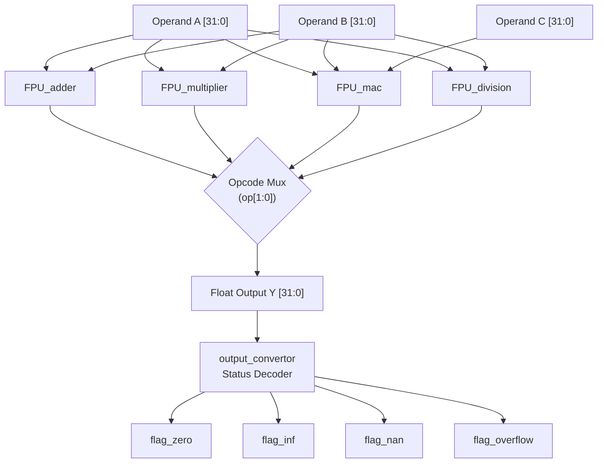
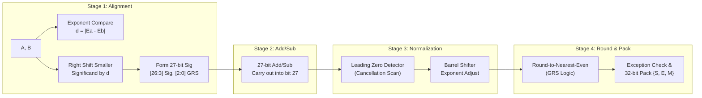
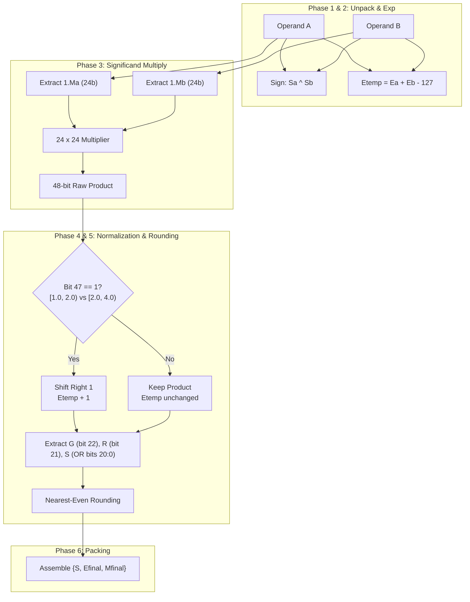
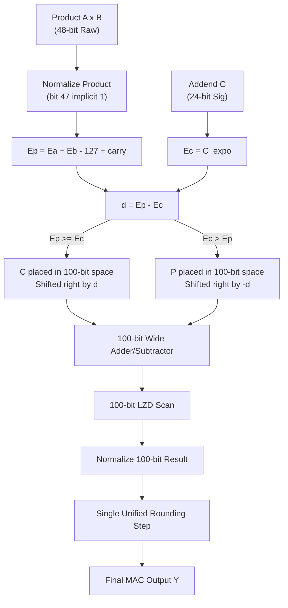

# Floating-Point Unit System Architecture & Block Diagrams

## 1. Top-Level Unified FPU Core (`rtl/FPU_top.v`)

---

## 2. FPU Adder Pipeline (`rtl/FPU_adder.v`)

---

## 3. FPU Multiplier Datapath (`rtl/FPU_multiplier.v`)

---

## 4. Fused Multiply-Accumulate (FMA) Dual-Path Alignment (`rtl/FPU_mac.v`)

