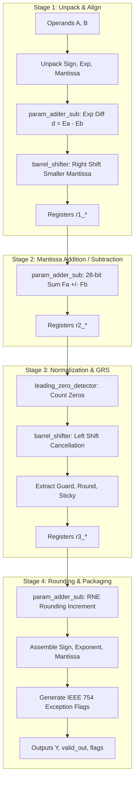

# Module Specification: `FPU_adder`

---

## 1. Overview & Architectural Role

`FPU_adder` is a fully pipelined, 4-stage synchronous floating-point arithmetic unit compliant with the IEEE 754-2008 standard for single-precision floating-point numbers. It performs both addition and subtraction ($Y = A \pm B$) through algebraic sign handling:

$$Y = A + B = (-1)^{S_A} \cdot 1.M_A \cdot 2^{E_A - 127} + (-1)^{S_B} \cdot 1.M_B \cdot 2^{E_B - 127}$$

### Key Features:
- **4-Stage Synchronous Pipeline**: Deterministic 4-cycle latency from `valid_in` to `valid_out`.
- **Sustained Throughput**: Accepts 1 new operation per clock cycle (100% throughput).
- **Subcomponent Instantiation**: Fully integrates `param_adder_sub`, `barrel_shifter`, and `leading_zero_detector`.
- **IEEE 754-2008 Exception Flags**: Generates `flag_overflow`, `flag_underflow`, `flag_invalid`, `flag_zero`, and `flag_inexact`.
- **Round-to-Nearest-Even (RNE)**: Complete Guard ($G$), Round ($R$), and Sticky ($S$) bit evaluation.

Source file: [`rtl/FPU_adder.v`](file:///c:/Users/LENOVO/Documents/GitHub/floating_point_unit/rtl/FPU_adder.v)  
Testbench: [`tb/sim_tb/tb_fpu_adder.v`](file:///c:/Users/LENOVO/Documents/GitHub/floating_point_unit/tb/sim_tb/tb_fpu_adder.v)

---

## 2. Port Interface Specification

```verilog
module FPU_adder (
    input  wire        clk,            // System Clock
    input  wire        rst_n,          // Active-low Asynchronous Reset
    input  wire        valid_in,       // Input Data Valid Strobe
    input  wire [31:0] A,              // IEEE 754 Float Operand A
    input  wire [31:0] B,              // IEEE 754 Float Operand B
    output reg  [31:0] Y,              // IEEE 754 Float Output Result
    output reg         valid_out,      // Output Data Valid Strobe (4 Cycles Latency)
    output reg         flag_overflow,  // Exponent Overflowed (> 254)
    output reg         flag_underflow, // Exponent Underflowed (< 1)
    output reg         flag_invalid,   // Invalid Operation (e.g. Inf - Inf, NaN)
    output reg         flag_zero,      // Result is Exact Zero
    output reg         flag_inexact    // Bits Discarded During Rounding
);
```

### Signal Descriptions

| Port | Width | Direction | Description |
| :--- | :---: | :---: | :--- |
| `clk` | 1 | Input | Positive-edge triggered system clock. |
| `rst_n` | 1 | Input | Active-low asynchronous system reset. |
| `valid_in` | 1 | Input | Input valid handshake strobe. |
| `A`, `B` | 32 | Input | 32-bit single-precision floating-point inputs. |
| `Y` | 32 | Output | 32-bit single-precision floating-point result. |
| `valid_out` | 1 | Output | Asserted 4 clock cycles after `valid_in` to indicate valid data on `Y`. |
| `flag_overflow` | 1 | Output | Exponent exceeded valid maximum ($E \ge 255$); saturates to $\pm\infty$. |
| `flag_underflow` | 1 | Output | Exponent underflowed below 1 ($E \le 0$). |
| `flag_invalid` | 1 | Output | $+\infty + (-\infty)$, or either operand is NaN; output is canonical QNaN. |
| `flag_zero` | 1 | Output | Result is numerical zero (`32'h00000000` or `32'h80000000`). |
| `flag_inexact` | 1 | Output | Inexact flag: truncation occurred during alignment or rounding. |

---

## 3. Pipeline Datapath Architecture



### Stage-by-Stage Implementation Details

#### Stage 1: Unpack, Compare Exponents & Align Significands
- Unpacks $S_A, E_A, M_A$ and $S_B, E_B, M_B$.
- Restores the implicit leading bit: $F_A = \{1'b1, M_A\}$, $F_B = \{1'b1, M_B\}$.
- Calculates exponent difference $d = E_A - E_B$ using `param_adder_sub`.
- Identifies the larger exponent: $E_{large} = \max(E_A, E_B)$.
- Aligns the smaller significand rightwards by $d$ positions using `barrel_shifter`.
- Preserves Guard ($G$), Round ($R$), and Sticky ($S$) bits in a 28-bit aligned space:
  $$\text{Aligned Significand} = \{\text{implicit 1}, M[22:0], G, R, S, 1'b0\}$$

#### Stage 2: Core Significand Addition / Subtraction
- Determines effective operation: $\text{eff\_sub} = S_A \oplus S_B$.
- Adds or subtracts the 28-bit aligned significands using `param_adder_sub`:
  $$\text{sum\_sigf} = F_{large} \pm F_{small\_aligned}$$
- Generates 28-bit sum and captures carry-out (`cout` at bit 27).

#### Stage 3: Normalization & Cancellation Handling
- Scans `sum_sigf[26:0]` with `leading_zero_detector` to find cancellation shift distance.
- **Carry-Out Condition (`sum_sigf[27] = 1`)**:
  - Right-shift sum by 1 bit using `barrel_shifter`.
  - Increment exponent by 1: $E_{norm} = E_{large} + 1$.
- **Cancellation Condition (`sum_sigf[27] = 0`)**:
  - Left-shift sum by `lzd_count` using `barrel_shifter`.
  - Decrement exponent: $E_{norm} = E_{large} - \text{lzd\_count}$.
- Extracts final 24-bit post-normalized significand, Guard bit, Round bit, and Sticky bit into Stage 3 registers (`r3_*`).

#### Stage 4: Round-to-Nearest-Even (RNE) & Output Packaging
- Computes RNE round increment:
  $$\text{round\_inc} = G \land (F[0] \lor R \lor S)$$
- Adds `round_inc` to 24-bit significand via `param_adder_sub`.
- Handles rounding overflow (e.g. `24'hFFFFFF` $+ 1 \rightarrow 24\text{'h1000000}$): shifts right by 1 and increments exponent.
- Formats 32-bit output: $Y = \{S_{final}, E_{final}[7:0], M_{final}[22:0]\}$.
- Drives `valid_out <= r3_valid` and asserts exception flags.

---

## 4. Verification & Simulation Guide

To compile, lint, simulate, and view waveforms in GTKWave:

```bash
./run fpu_adder
```

### Verified Test Categories (36/36 Tests Pass):
1. **Direct Arithmetic**: $1.0 + 1.0 = 2.0$, $2.5 + 3.75 = 6.25$, $10.0 + 5.0 = 15.0$, $128.0 + 128.0 = 256.0$.
2. **Subtraction**: $10.0 - 2.5 = 7.5$, $3.75 - 1.25 = 2.5$, $-5.0 + 10.0 = 5.0$, $-100.0 + 50.0 = -50.0$.
3. **Corner Cases**: $0.0 + 0.0 = 0.0$, $100.0 + (-100.0) = 0.0$ (`flag_zero = 1`).
4. **Infinities & NaNs**: $+\infty + 5.0 = +\infty$, $+\infty + (-\infty) = \text{NaN}$ (`flag_invalid = 1`).
5. **Streaming Throughput**: 5 consecutive vectors applied on consecutive clock cycles, producing 5 back-to-back results with sustained 100% throughput.
