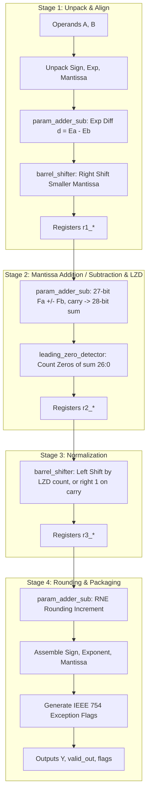

# Module Specification: `FPU_adder`

---

## 1. Overview & Architectural Role

`FPU_adder` is a fully pipelined, 4-stage synchronous IEEE 754 binary32 adder. It is bit-exact for normal operands but **not fully IEEE 754 compliant** (no subnormal support, sign-of-zero and NaN-flag deviations; see [§5](#5-known-limitations-measured)). It performs both addition and subtraction ($Y = A \pm B$) through algebraic sign handling:

$$Y = A + B = (-1)^{S_A} \cdot 1.M_A \cdot 2^{E_A - 127} + (-1)^{S_B} \cdot 1.M_B \cdot 2^{E_B - 127}$$

### Key Features:
- **4-Stage Synchronous Pipeline**: 4 register stages; `valid_out` rises on the 4th rising edge counting the edge that captures the input.
- **Sustained Throughput**: Accepts 1 new operation per clock cycle (verified with 32 back-to-back operations).
- **Subcomponent Instantiation**: Uses `param_adder_sub`, `barrel_shifter`, and `leading_zero_detector`.
- **Status Flags**: `flag_overflow`, `flag_underflow`, `flag_invalid`, `flag_zero`, and `flag_inexact`.
- **Round-to-Nearest-Even (RNE)** only, using Guard ($G$), Round ($R$), and Sticky ($S$) bits.
- **Timing (Sky130, pre-layout)**: meets 100 MHz with +1.04 ns slack (~112 MHz).

Source file: [`rtl/FPU_adder.v`](file:///c:/Users/LENOVO/Documents/GitHub/floating_point_unit/rtl/FPU_adder.v)  
Testbench: [`tb/sim_tb/tb_fpu_adder.v`](file:///c:/Users/LENOVO/Documents/GitHub/floating_point_unit/tb/sim_tb/tb_fpu_adder.v)

---

## 2. Port Interface Specification

```verilog
module FPU_adder (
    input  wire        clk,            // System Clock
    input  wire        rst_n,          // Active-low Asynchronous Reset
    input  wire        valid_in,       // Input Data Valid Strobe
    input  wire [31:0] A,              // IEEE 754 Float Operand A
    input  wire [31:0] B,              // IEEE 754 Float Operand B
    output reg  [31:0] Y,              // IEEE 754 Float Output Result
    output reg         valid_out,      // Output Data Valid Strobe (4 Cycles Latency)
    output reg         flag_overflow,  // Exponent Overflowed (> 254)
    output reg         flag_underflow, // Exponent Underflowed (< 1)
    output reg         flag_invalid,   // Invalid Operation (e.g. Inf - Inf, NaN)
    output reg         flag_zero,      // Result is Exact Zero
    output reg         flag_inexact    // Bits Discarded During Rounding
);
```

### Signal Descriptions

| Port | Width | Direction | Description |
| :--- | :---: | :---: | :--- |
| `clk` | 1 | Input | Positive-edge triggered system clock. |
| `rst_n` | 1 | Input | Active-low asynchronous system reset. |
| `valid_in` | 1 | Input | Input valid handshake strobe. |
| `A`, `B` | 32 | Input | 32-bit single-precision floating-point inputs. |
| `Y` | 32 | Output | 32-bit single-precision floating-point result. |
| `valid_out` | 1 | Output | Asserted 4 clock cycles after `valid_in` to indicate valid data on `Y`. |
| `flag_overflow` | 1 | Output | Exponent exceeded valid maximum ($E \ge 255$); saturates to $\pm\infty$. |
| `flag_underflow` | 1 | Output | Normalized exponent reached 0; the result is **flushed to ±0** (no subnormal output). |
| `flag_invalid` | 1 | Output | $+\infty + (-\infty)$, or either operand is NaN (quiet or signaling; IEEE would not flag quiet NaNs); output is canonical QNaN. |
| `flag_zero` | 1 | Output | Result is numerical zero (`32'h00000000` or `32'h80000000`). |
| `flag_inexact` | 1 | Output | Inexact flag: truncation occurred during alignment or rounding. |

---

## 3. Pipeline Datapath Architecture



### Stage-by-Stage Implementation Details

#### Stage 1: Unpack, Compare Exponents & Align Significands
- Unpacks $S_A, E_A, M_A$ and $S_B, E_B, M_B$.
- Restores the implicit leading bit: $F = \{1'b1, M\}$ for $E \ne 0$, $\{1'b0, M\}$ for $E = 0$. For subnormal inputs the exponent is still taken as the field value 0, not the effective exponent 1, which makes subnormal + normal results wrong (§5).
- Calculates both $E_A - E_B$ and $E_B - E_A$ with `param_adder_sub` and uses the borrow to pick $d = |E_A - E_B|$ and $E_{large} = \max(E_A, E_B)$.
- Aligns the smaller significand rightwards by $d$ positions (saturated at 49) using a 49-bit `barrel_shifter`.
- Builds 27-bit operands for Stage 2:
  $$F_{large} = \{1.M, 3'b000\}, \qquad F_{small} = \{\text{shifted}[48:23], S\}$$
  where $S$ is the OR of all bits shifted below the round position.
- Special cases (NaN, ∞, zero operands) select a bypass result here.

#### Stage 2: Core Significand Addition / Subtraction
- Determines effective operation: $\text{eff\_sub} = S_A \oplus S_B$.
- Adds or subtracts the 27-bit aligned significands using `param_adder_sub`:
  $$\text{sum\_sigf} = F_{large} \pm F_{small\_aligned}$$
- For addition the carry-out becomes bit 27 of a 28-bit sum.
- Scans `sum_sigf[26:0]` with `leading_zero_detector` (in this same stage) to find the cancellation shift distance.

#### Stage 3: Normalization & Cancellation Handling
- **Carry-Out Condition (`sum_sigf[27] = 1`)**:
  - Right-shift sum by 1 bit using `barrel_shifter`.
  - Increment exponent by 1: $E_{norm} = E_{large} + 1$.
- **Cancellation Condition (`sum_sigf[27] = 0`)**:
  - Left-shift sum by `lzd_count` using `barrel_shifter`.
  - Decrement exponent: $E_{norm} = E_{large} - \text{lzd\_count}$, or 0 if that would not be positive.
- Registers the normalized 28-bit significand and exponent into Stage 3 registers (`r3_*`). Stage 4 reads the 24-bit significand from bits [26:3] and GRS from bits [2:0].

#### Stage 4: Round-to-Nearest-Even (RNE) & Output Packaging
- Computes RNE round increment:
  $$\text{round\_inc} = G \land (F[0] \lor R \lor S)$$
- Adds `round_inc` to 24-bit significand via `param_adder_sub`.
- Handles rounding overflow (e.g. `24'hFFFFFF` $+ 1 \rightarrow 24\text{'h1000000}$): shifts right by 1 and increments exponent.
- Formats 32-bit output: $Y = \{S_{final}, E_{final}[7:0], M_{final}[22:0]\}$. If $E_{final} \ge 255$ the result is ±∞; if the normalized exponent is 0 the result is ±0 (flush-to-zero).
- Drives `valid_out <= r3_valid` and asserts exception flags.

---

## 4. Verification & Simulation Guide

To compile, lint, simulate, and view waveforms in GTKWave:

```bash
./run fpu_adder
```

### Verified Test Categories (36/36 Tests Pass):
1. **Direct Arithmetic**: $1.0 + 1.0 = 2.0$, $2.5 + 3.75 = 6.25$, $10.0 + 5.0 = 15.0$, $128.0 + 128.0 = 256.0$.
2. **Subtraction**: $10.0 - 2.5 = 7.5$, $3.75 - 1.25 = 2.5$, $-5.0 + 10.0 = 5.0$, $-100.0 + 50.0 = -50.0$.
3. **Corner Cases**: $0.0 + 0.0 = 0.0$, $100.0 + (-100.0) = 0.0$ (`flag_zero = 1`).
4. **Infinities & NaNs**: $+\infty + 5.0 = +\infty$, $+\infty + (-\infty) = \text{NaN}$ (`flag_invalid = 1`).
5. **Streaming Throughput**: 5 consecutive vectors applied on consecutive clock cycles, producing 5 back-to-back results with sustained 100% throughput.

The corner-case suite (`./run corner_adder`, 93 tests) covers zeros, infinities, NaNs, flags and a random sign-quadrant loop, but **no subnormal operands or results**. Its test #14 expects `(+0.0) + (−0.0) = −0.0`, so it passes on the sign-of-zero deviation described below rather than catching it.

---

## 5. Known Limitations (measured)

Independent bit-exact audit against an exact IEEE 754 reference (2026-10-18):

| Stimulus | Bit-exact |
|---|:---:|
| Normal inputs, full exponent range | **3,000 / 3,000** |
| Mixed (incl. subnormal operands and specials) | 4,565 / 5,052 |

| Case | Expected | Got |
|---|---|---|
| `0x00000001 + 0x00000001` | `0x00000002` | `0x00000000` (flush-to-zero, `flag_underflow=1`) |
| `0x00540245 + 0x01A4B37C` (subnormal + normal) | `0x01B9B40D` | `0x01AF33C5` |
| `+0 + −0` | `0x00000000` | `0x80000000` |
| `qNaN + 1.0` | `flag_invalid = 0` | `flag_invalid = 1` |

Causes:
1. Stage 4 packs any result with normalized exponent 0 as ±0.
2. Subnormal operands are aligned using exponent 0 instead of 1.
3. The zero bypass returns `B` whenever `A` is zero, so `+0 + −0` → `−0`.
4. `flag_invalid` is set for any NaN operand.
