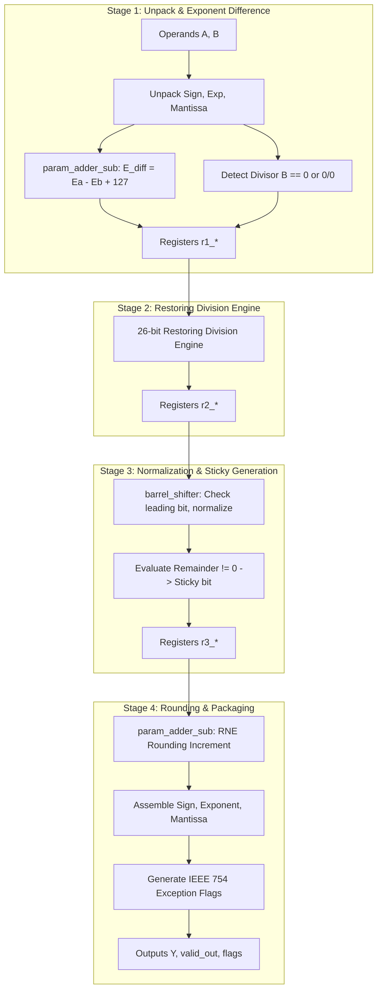

# Module Specification: `FPU_division`

---

## 1. Overview & Architectural Role

`FPU_division` is a 4-stage synchronous pipelined floating-point divider complying with the IEEE 754-2008 standard. It computes the single-precision quotient of two floating-point numbers:

$$Y = \frac{A}{B} = \frac{(-1)^{S_A} \cdot 1.M_A \cdot 2^{E_A - 127}}{(-1)^{S_B} \cdot 1.M_B \cdot 2^{E_B - 127}} = (-1)^{S_A \oplus S_B} \cdot \left(\frac{1.M_A}{1.M_B}\right) \cdot 2^{(E_A - E_B + 127) - 127}$$

### Key Features:
- **4-Stage Synchronous Pipeline**: Deterministic 4-cycle latency from `valid_in` to `valid_out`.
- **Sustained Throughput**: Accepts 1 new operation per clock cycle (100% throughput).
- **Subcomponent Instantiation**: Fully integrates `param_adder_sub` and `barrel_shifter`.
- **IEEE 754-2008 Exception Handling**: Decomposed flags for `flag_overflow`, `flag_underflow`, `flag_invalid`, `flag_div_by_zero`, `flag_zero`, and `flag_inexact`.
- **Restoring Division Core**: Computes 26 bits of exact quotient with non-zero remainder evaluation for the GRS Sticky bit.

Source file: [`rtl/FPU_division.v`](file:///c:/Users/LENOVO/Documents/GitHub/floating_point_unit/rtl/FPU_division.v)  
Testbench: [`tb/sim_tb/tb_fpu_division.v`](file:///c:/Users/LENOVO/Documents/GitHub/floating_point_unit/tb/sim_tb/tb_fpu_division.v)

---

## 2. Port Interface Specification

```verilog
module FPU_division (
    input  wire        clk,             // System Clock
    input  wire        rst_n,           // Active-low Asynchronous Reset
    input  wire        valid_in,        // Input Data Valid Strobe
    input  wire [31:0] A,               // IEEE 754 Float Dividend A
    input  wire [31:0] B,               // IEEE 754 Float Divisor B
    output reg  [31:0] Y,               // IEEE 754 Float Quotient Result
    output reg         valid_out,       // Output Data Valid Strobe (4 Cycles Latency)
    output reg         flag_overflow,   // Exponent Overflowed (> 254)
    output reg         flag_underflow,  // Exponent Underflowed (< 1)
    output reg         flag_invalid,    // Invalid Operation (e.g. 0/0, Inf/Inf)
    output reg         flag_div_by_zero,// Divisor is Zero (B == 0)
    output reg         flag_zero,       // Quotient is Zero (A == 0)
    output reg         flag_inexact     // Bits Discarded During Truncation/Rounding
);
```

### Signal Descriptions

| Port | Width | Direction | Description |
| :--- | :---: | :---: | :--- |
| `clk` | 1 | Input | Positive-edge triggered system clock. |
| `rst_n` | 1 | Input | Active-low asynchronous system reset. |
| `valid_in` | 1 | Input | Input valid handshake strobe. |
| `A` | 32 | Input | Dividend operand (numerator). |
| `B` | 32 | Input | Divisor operand (denominator). |
| `Y` | 32 | Output | 32-bit single-precision floating-point quotient. |
| `valid_out` | 1 | Output | Asserted 4 clock cycles after `valid_in`. |
| `flag_div_by_zero`| 1 | Output | Asserted when $B=0$ and $A \ne 0$; output is $\pm\infty$. |
| `flag_invalid` | 1 | Output | $0.0 / 0.0$, $\infty / \infty$, or NaN operands; output is canonical QNaN. |
| `flag_overflow` | 1 | Output | Exponent $\ge 255$; output saturates to $\pm\infty$. |
| `flag_underflow` | 1 | Output | Exponent $\le 0$; underflow detected. |
| `flag_zero` | 1 | Output | Dividend $A = 0$ ($B \ne 0$). |
| `flag_inexact` | 1 | Output | Non-zero division remainder or rounding truncation. |

---

## 3. Pipeline Datapath Architecture



### Stage-by-Stage Implementation Details

#### Stage 1: Unpack, Div-by-Zero Check & Exponent Difference
- Unpacks $S_A, E_A, M_A$ and $S_B, E_B, M_B$.
- Sign of quotient: $S_Q = S_A \oplus S_B$.
- Restores 24-bit significands: $F_A = \{1'b1, M_A\}$, $F_B = \{1'b1, M_B\}$.
- Calculates unbiased exponent: $E_{diff} = E_A - E_B + 127$ using `param_adder_sub`.
- Special conditions:
  - **Division by Zero ($B = 0, A \ne 0$)**: Asserts `flag_div_by_zero = 1`, forces $Y = \pm\infty$.
  - **Indeterminate Form ($A = 0, B = 0$)**: Asserts `flag_invalid = 1`, forces $Y = \text{QNaN}$.

#### Stage 2: Restoring Significand Division
- Performs bit-by-bit restoring division over 26 fractional steps:
  $$\text{Dividend } F_A \div \text{Divisor } F_B$$
- Generates 26 quotient bits ($Q[25:0]$) and the final non-zero remainder.

#### Stage 3: Normalization & Remainder Sticky Extraction
Since $F_A, F_B \in [1.0, 2.0)$, the quotient $Q \in (0.5, 2.0)$:
- **If $Q[25] = 1$ ($Q \in [1.0, 2.0)$)**:
  - Already normalized.
  - Normalized significand $= Q[25:2]$.
  - Guard bit $G = Q[1]$, Round bit $R = Q[0]$, Sticky bit $S = (\text{Remainder} \ne 0)$.
- **If $Q[25] = 0$ ($Q \in (0.5, 1.0)$)**:
  - Shift left by 1 bit using `barrel_shifter`.
  - Decrement exponent by 1: $E_{norm} = E_{diff} - 1$.
  - Normalized significand $= Q[24:1]$.
  - Guard bit $G = Q[0]$, Round bit $R = 1'b0$, Sticky bit $S = (\text{Remainder} \ne 0)$.

#### Stage 4: Round-to-Nearest-Even (RNE) & Output Packaging
- Adds RNE rounding increment via `param_adder_sub`.
- Assembles final 32-bit float: $Y = \{S_Q, E_{final}[7:0], M_{final}[22:0]\}$.
- Drives `valid_out` and generates overflow, underflow, and inexact flags.

---

## 4. Verification & Simulation Guide

To compile, lint, simulate, and view waveforms in GTKWave:

```bash
./run fpu_division
```

### Verified Test Categories (24/24 Tests Pass):
1. **Direct Quotients**: $1.0 / 1.0 = 1.0$, $10.0 / 2.0 = 5.0$, $7.5 / 2.5 = 3.0$, $1.0 / 4.0 = 0.25$.
2. **Signed Division**: $-10.0 / 2.0 = -5.0$, $10.0 / -2.0 = -5.0$, $-10.0 / -2.0 = 5.0$.
3. **Corner Cases**: $0.0 / 5.0 = 0.0$, $5.0 / 0.0 = +\infty$ (`flag_div_by_zero = 1`).
4. **Special Forms**: $0.0 / 0.0 = \text{NaN}$ (`flag_invalid = 1`), $\infty / \infty = \text{NaN}$.
5. **Streaming Throughput**: 5 back-to-back vectors on consecutive cycles sustaining 1 op/cycle.
