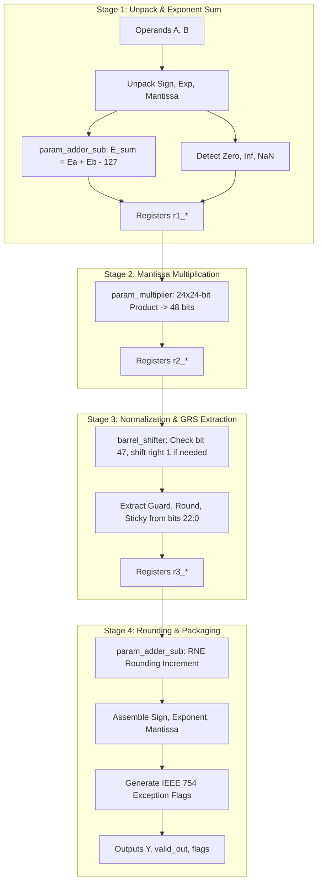

# Module Specification: `FPU_multiplier`

---

## 1. Overview & Architectural Role

`FPU_multiplier` is a 4-stage synchronous pipelined IEEE 754-2008 single-precision floating-point multiplier. It performs the multiplication of two floating-point numbers:

$$Y = A \times B = \left((-1)^{S_A} \cdot 1.M_A \cdot 2^{E_A - 127}\right) \times \left((-1)^{S_B} \cdot 1.M_B \cdot 2^{E_B - 127}\right)$$
$$Y = (-1)^{S_A \oplus S_B} \cdot (1.M_A \times 1.M_B) \cdot 2^{(E_A + E_B - 127) - 127}$$

### Key Features:
- **4-Stage Synchronous Pipeline**: Deterministic 4-cycle latency from `valid_in` to `valid_out`.
- **Sustained Throughput**: Accepts 1 new operation per clock cycle (100% throughput).
- **Subcomponent Instantiation**: Fully integrates `param_multiplier`, `param_adder_sub`, and `barrel_shifter`.
- **Full IEEE 754-2008 Exception Handling**: `flag_overflow`, `flag_underflow`, `flag_invalid`, `flag_zero`, `flag_inexact`.
- **Round-to-Nearest-Even (RNE)**: Comprehensive 48-bit product reduction and GRS rounding.

Source file: [`rtl/FPU_multiplier.v`](file:///c:/Users/LENOVO/Documents/GitHub/floating_point_unit/rtl/FPU_multiplier.v)  
Testbench: [`tb/sim_tb/tb_fpu_multiplier.v`](file:///c:/Users/LENOVO/Documents/GitHub/floating_point_unit/tb/sim_tb/tb_fpu_multiplier.v)

---

## 2. Port Interface Specification

```verilog
module FPU_multiplier (
    input  wire        clk,            // System Clock
    input  wire        rst_n,          // Active-low Asynchronous Reset
    input  wire        valid_in,       // Input Data Valid Strobe
    input  wire [31:0] A,              // IEEE 754 Float Operand A
    input  wire [31:0] B,              // IEEE 754 Float Operand B
    output reg  [31:0] Y,              // IEEE 754 Float Output Result
    output reg         valid_out,      // Output Data Valid Strobe (4 Cycles Latency)
    output reg         flag_overflow,  // Exponent Overflowed (> 254)
    output reg         flag_underflow, // Exponent Underflowed (< 1)
    output reg         flag_invalid,   // Invalid Operation (e.g. 0 * Inf, NaN)
    output reg         flag_zero,      // Result is Exact Zero
    output reg         flag_inexact    // Bits Discarded During Rounding
);
```

### Signal Descriptions

| Port | Width | Direction | Description |
| :--- | :---: | :---: | :--- |
| `clk` | 1 | Input | Positive-edge triggered system clock. |
| `rst_n` | 1 | Input | Active-low asynchronous system reset. |
| `valid_in` | 1 | Input | Input valid handshake strobe. |
| `A`, `B` | 32 | Input | 32-bit single-precision floating-point inputs. |
| `Y` | 32 | Output | 32-bit single-precision floating-point product. |
| `valid_out` | 1 | Output | Asserted 4 clock cycles after `valid_in` to indicate valid data on `Y`. |
| `flag_overflow` | 1 | Output | Exponent $\ge 255$; output saturates to $\pm\infty$. |
| `flag_underflow` | 1 | Output | Exponent $\le 0$; underflow detected. |
| `flag_invalid` | 1 | Output | $0.0 \times \pm\infty$ or NaN operands; output is canonical QNaN. |
| `flag_zero` | 1 | Output | Result is zero ($A=0$ or $B=0$). |
| `flag_inexact` | 1 | Output | Inexact flag: lower bits of product discarded during rounding. |

---

## 3. Pipeline Datapath Architecture



### Stage-by-Stage Implementation Details

#### Stage 1: Unpack & Exponent Summation
- Unpacks $S_A, E_A, M_A$ and $S_B, E_B, M_B$.
- Computes tentative sign: $S_{prod} = S_A \oplus S_B$.
- Restores 24-bit significands: $F_A = \{1'b1, M_A\}$, $F_B = \{1'b1, M_B\}$.
- Calculates unbiased exponent sum using `param_adder_sub`:
  $$E_{sum} = E_A + E_B - 127$$
- Detects special cases: Zero ($A=0 \lor B=0$), Infinity ($A=\infty \lor B=\infty$), and NaN ($0 \times \infty$ or NaN).

#### Stage 2: Core 24x24-bit Significand Multiplication
- Multiplies $F_A$ and $F_B$ using `param_multiplier`:
  $$\text{product}[47:0] = F_A[23:0] \times F_B[23:0]$$
- Registers product, exponent, sign, and special case flags into Stage 2 registers (`r2_*`).

#### Stage 3: Normalization & GRS Bit Extraction
Since both inputs are in $[1.0, 2.0)$, the product is bounded in $[1.0, 4.0)$:
- **Case 1: Bit 47 is 1 ($\text{product} \in [2.0, 4.0)$)**:
  - Shift product right by 1 bit using `barrel_shifter`.
  - Increment exponent by 1: $E_{norm} = E_{sum} + 1$.
  - Normalized significand $= \text{product}[47:24]$.
  - Guard bit $G = \text{product}[23]$, Round bit $R = \text{product}[22]$, Sticky bit $S = |\text{product}[21:0]$.
- **Case 2: Bit 47 is 0 ($\text{product} \in [1.0, 2.0)$)**:
  - Normalized significand $= \text{product}[46:23]$.
  - Guard bit $G = \text{product}[22]$, Round bit $R = \text{product}[21]$, Sticky bit $S = |\text{product}[20:0]$.

#### Stage 4: Round-to-Nearest-Even (RNE) & Packaging
- Evaluates RNE rounding increment: $\text{round\_inc} = G \land (F[0] \lor R \lor S)$.
- Adds `round_inc` to significand using `param_adder_sub`.
- Formats 32-bit output: $Y = \{S_{prod}, E_{final}[7:0], M_{final}[22:0]\}$.
- Asserts `valid_out` and generates overflow/underflow flags.

---

## 4. Verification & Simulation Guide

To compile, lint, simulate, and view waveforms in GTKWave:

```bash
./run fpu_multiplier
```

### Verified Test Categories (25/25 Tests Pass):
1. **Direct Multiplications**: $1.0 \times 1.0 = 1.0$, $2.0 \times 3.0 = 6.0$, $2.5 \times 4.0 = 10.0$, $10.0 \times 10.0 = 100.0$.
2. **Fractions & Signs**: $0.5 \times 0.5 = 0.25$, $-2.0 \times 3.0 = -6.0$, $-10.0 \times -5.0 = 50.0$.
3. **Corner Cases**: $0.0 \times 5.0 = 0.0$, $0.0 \times 0.0 = 0.0$, $1.0 \times 42.0 = 42.0$.
4. **Special Values**: $0.0 \times \infty = \text{NaN}$ (`flag_invalid = 1`), $\infty \times 5.0 = \infty$.
5. **Streaming Throughput**: 5 back-to-back vectors on consecutive cycles sustaining 1 op/cycle.
