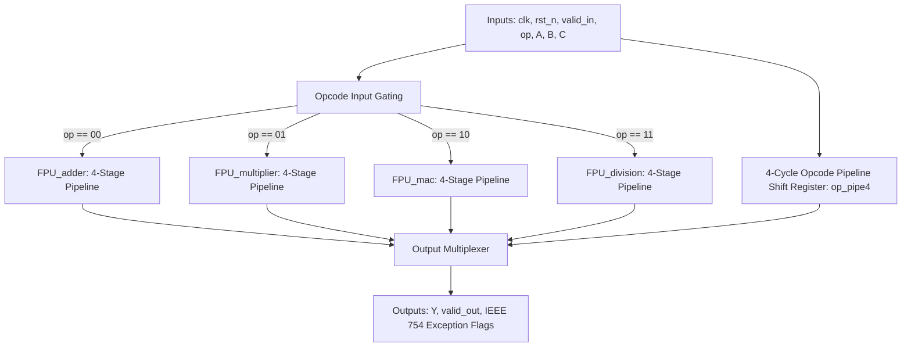

# Module Specification: `FPU_top`

---

## 1. Overview & Architectural Role

`FPU_top` is the top-level integration wrapper for the entire 32-bit IEEE 754-2008 Floating-Point Unit. It unifies the 4 execution blocks (`FPU_adder`, `FPU_multiplier`, `FPU_mac`, and `FPU_division`) under a centralized 2-bit opcode interface.

### Opcode Mapping:
- `op = 2'b00` : **Addition / Subtraction** ($Y = A + B$)
- `op = 2'b01` : **Multiplication** ($Y = A \times B$)
- `op = 2'b10` : **Fused Multiply-Add / MAC** ($Y = A \times B + C$)
- `op = 2'b11` : **Division** ($Y = A \div B$)

### Key Features:
- **Unified Latency**: All four units have 4 register stages. `valid_out` rises on the 4th rising edge counting the edge that captures the input, for every opcode.
- **1 op/cycle, mixed opcodes**: Verified by streaming a repeating ADD→MUL→FMA→DIV sequence and 20,000 random mixed-opcode operations on consecutive cycles. All results returned in order.
- **Clocked Opcode Pipeline**: A 4-deep register chain (`op_pipe1..4`) tracks `op` so the output multiplexer selects the unit whose result is arriving.
- **Status Flags**: `flag_zero`, `flag_inf`, `flag_nan`, `flag_invalid`, `flag_overflow`, `flag_underflow`, `flag_inexact`, and `flag_div_by_zero`.
- **Not included**: `input_convertor` / `output_convertor` are not instantiated here (they are standalone components).
- **Clock rate**: the four units share one clock, so the divider sets the limit. Minimum period is **100.506 ns (9.95 MHz)** in Sky130 synthesis with the repo's STA script, or 105.789 ns (9.45 MHz) with `timing.sdc` constraints.

Source file: [`rtl/FPU_top.v`](file:///c:/Users/LENOVO/Documents/GitHub/floating_point_unit/rtl/FPU_top.v)  
Testbench: [`tb/sim_tb/tb_fpu_top.v`](file:///c:/Users/LENOVO/Documents/GitHub/floating_point_unit/tb/sim_tb/tb_fpu_top.v)

---

## 2. Port Interface Specification

```verilog
module FPU_top (
    input  wire        clk,             // System Clock
    input  wire        rst_n,           // Active-low Asynchronous Reset
    input  wire        valid_in,        // Input Data Valid Strobe
    input  wire [1:0]  op,              // Operation Select (00:Add, 01:Mul, 10:MAC, 11:Div)
    input  wire [31:0] A,               // IEEE 754 Float Operand A
    input  wire [31:0] B,               // IEEE 754 Float Operand B
    input  wire [31:0] C,               // IEEE 754 Float Operand C (used in MAC: A*B + C)
    output reg  [31:0] Y,               // IEEE 754 Float Result Output
    output reg         valid_out,       // Output Valid Strobe (4 Cycles Latency)
    output reg         flag_zero,       // Output is Zero
    output reg         flag_inf,        // Output is Infinity
    output reg         flag_nan,        // Output is NaN
    output reg         flag_invalid,    // Invalid Operation (e.g. Inf - Inf, 0/0)
    output reg         flag_overflow,   // Exponent Overflowed (> 254)
    output reg         flag_underflow,  // Exponent Underflowed (< 1)
    output reg         flag_inexact,    // Bits Discarded During Rounding
    output reg         flag_div_by_zero // Division by Zero (B == 0)
);
```

### Signal Descriptions

| Port | Width | Direction | Description |
| :--- | :---: | :---: | :--- |
| `clk` | 1 | Input | Positive-edge triggered system clock. |
| `rst_n` | 1 | Input | Active-low asynchronous system reset. |
| `valid_in` | 1 | Input | Strobe indicating valid inputs on `A`, `B`, `C`, and `op`. |
| `op` | 2 | Input | Opcode: `00` = Add/Sub, `01` = Mul, `10` = MAC, `11` = Div. |
| `A`, `B`, `C` | 32 | Input | 32-bit single-precision float inputs. |
| `Y` | 32 | Output | 32-bit single-precision float output. |
| `valid_out` | 1 | Output | Valid strobe asserted 4 clock cycles after `valid_in`. |
| `flag_*` | 1 | Output | Decomposed IEEE 754 status and exception flags. |

---

## 3. Top-Level Datapath Architecture



### Opcode Delay Pipeline
To ensure that the output multiplexer selects the result of the operation issued 4 clock edges earlier, `op` is shifted through four registers. `valid_in` is not delayed here; each unit carries its own valid bit through its pipeline, and the selected unit's `valid_out` is forwarded.
```verilog
always @(posedge clk or negedge rst_n) begin
    if (!rst_n) begin
        op_pipe1 <= 2'b00; op_pipe2 <= 2'b00; op_pipe3 <= 2'b00; op_pipe4 <= 2'b00;
    end else begin
        op_pipe1 <= op; op_pipe2 <= op_pipe1; op_pipe3 <= op_pipe2; op_pipe4 <= op_pipe3;
    end
end
```

Each unit's `valid_in` is gated by the opcode, e.g. `.valid_in(valid_in && (op == 2'b00))` for the adder.

### Output Routing:
```verilog
always @(*) begin
    case (op_pipe4)
        2'b00: begin // ADD / SUB
            Y = y_add; valid_out = v_add; flag_overflow = ovf_add;
            flag_underflow = unf_add; flag_invalid = inv_add; flag_zero = z_add;
            flag_inexact = inex_add; flag_div_by_zero = 1'b0;
        end
        2'b01: begin // MULTIPLY
            Y = y_mul; valid_out = v_mul; flag_overflow = ovf_mul;
            flag_underflow = unf_mul; flag_invalid = inv_mul; flag_zero = z_mul;
            flag_inexact = inex_mul; flag_div_by_zero = 1'b0;
        end
        2'b10: begin // MAC / FMA
            Y = y_mac; valid_out = v_mac; flag_overflow = ovf_mac;
            flag_underflow = unf_mac; flag_invalid = inv_mac; flag_zero = z_mac;
            flag_inexact = inex_mac; flag_div_by_zero = 1'b0;
        end
        2'b11: begin // DIVISION
            Y = y_div; valid_out = v_div; flag_overflow = ovf_div;
            flag_underflow = unf_div; flag_invalid = inv_div; flag_zero = z_div;
            flag_inexact = inex_div; flag_div_by_zero = dz_div;
        end
        default: begin /* all outputs 0 */ end
    endcase

    flag_inf = (Y[30:23] == 8'hFF) && (Y[22:0] == 23'h0);
    flag_nan = (Y[30:23] == 8'hFF) && (Y[22:0] != 23'h0);
end
```

---

## 4. Verification & Simulation Guide

To compile, lint, simulate, and view waveforms for the entire suite in GTKWave:

```bash
./run top
```

### Summary of the 180-Test Suite (`tb/sim_tb/tb_fpu_top.v`)
Counts from the 2026-10-18 re-run log. The testbench's section banners print slightly different nominal numbers.
- **`input_convertor`**: 30 tests (integers & Q16.16 fixed-point to float).
- **`output_convertor`**: 25 tests (float to integer & Q16.16, field unpacking, flags).
- **`FPU_adder`**: 45 tests (30 + 15 additional vectors).
- **`FPU_multiplier`**: 25 tests.
- **`FPU_mac`**: 25 tests.
- **`FPU_division`**: 26 tests.
- **`FPU_top`**: 4 tests, one per opcode, checking the output multiplexer.
- **Result**: **180/180 passed**.

Other suites that target `FPU_top`: `./run crv` (1,000 random transactions, property checks only, **no golden model**), `./run large` (2,800 identity-law vectors), `./run corner_top` (128) and `./run cocotb` (4,052, ±1 ULP tolerance).

---

## 5. Known Limitations (measured)

Independent bit-exact audit of `FPU_top` against an exact IEEE 754 reference (2026-10-18), 20,000 back-to-back mixed-opcode operations:

| Outcome | Count |
|---|:---:|
| Bit-exact | 18,638 (93.19%) |
| Subnormal result flushed to zero | 1,036 (5.18%) |
| Wrong value (subnormal operands; FMA alignment bug) | 326 (1.63%) |

With normal inputs only: ADD 3,000/3,000, MUL 2,890/3,000, FMA 2,981/3,000, DIV 2,860/3,000 bit-exact.

See [`architecture.md` §4](architecture.md#4-deviations-from-ieee-754) for the full list of deviations: no subnormals, subnormal-input errors, FMA large-gap alignment wrap, `+0 + −0 → −0`, `flag_invalid` on quiet NaNs, RNE only.
